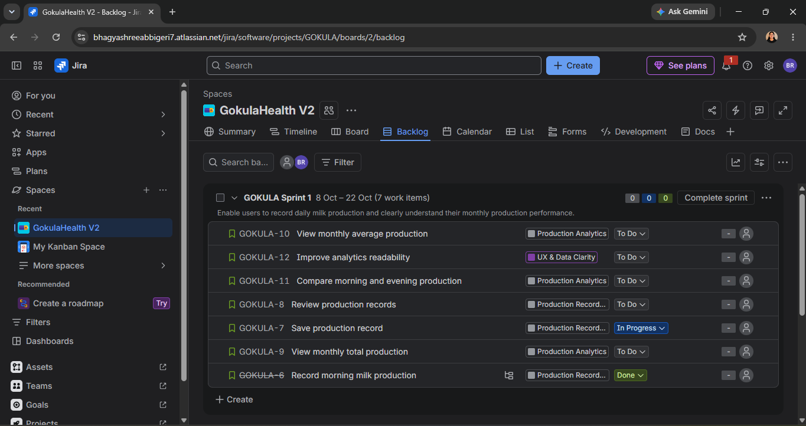
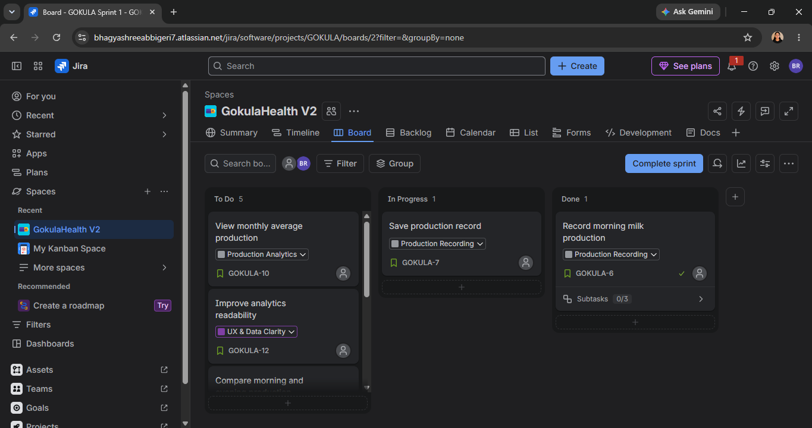
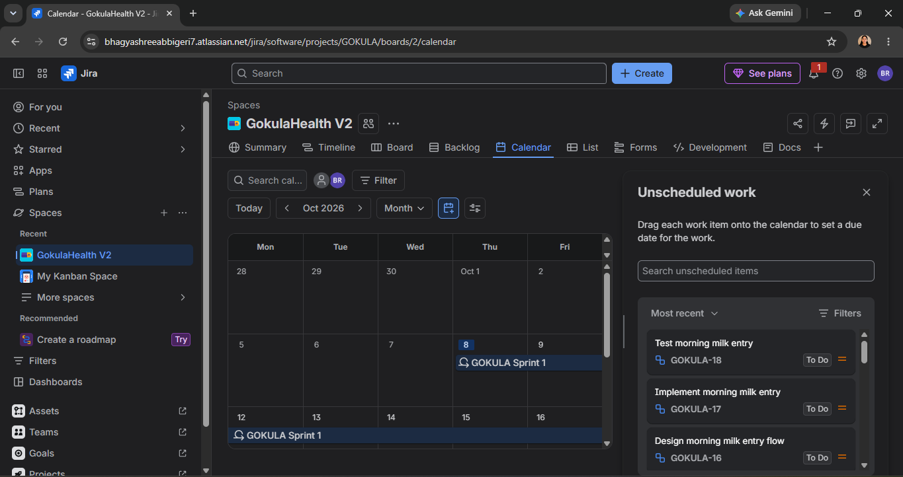
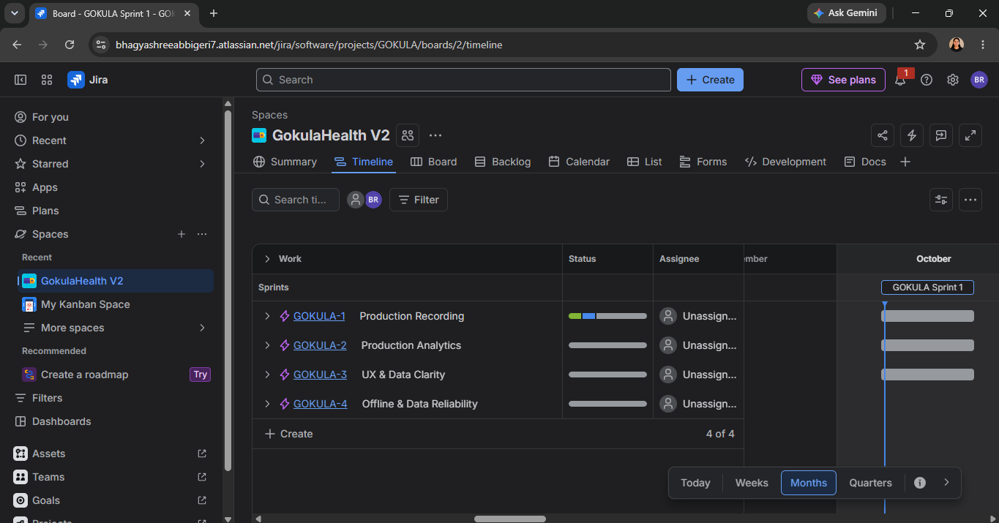
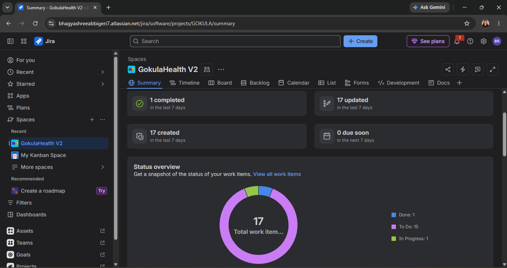
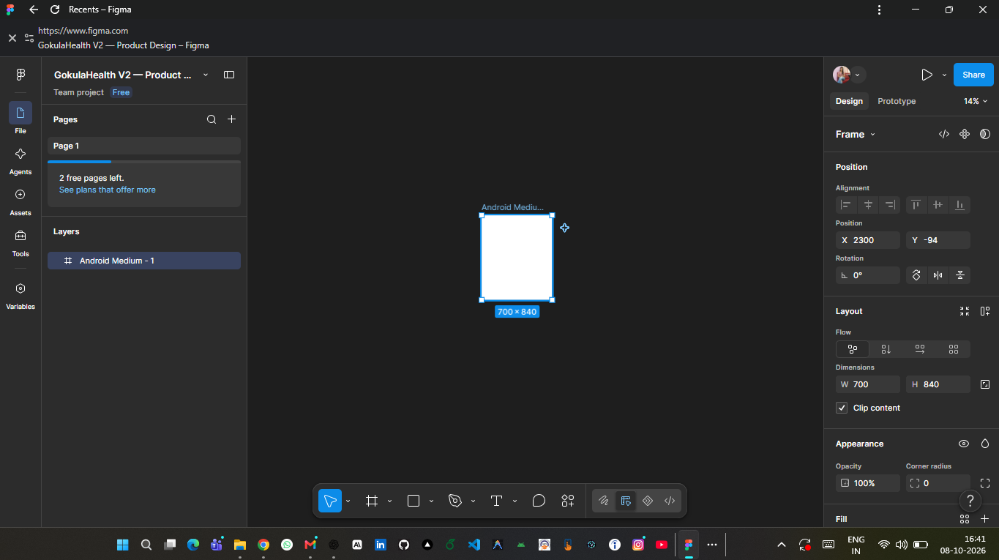
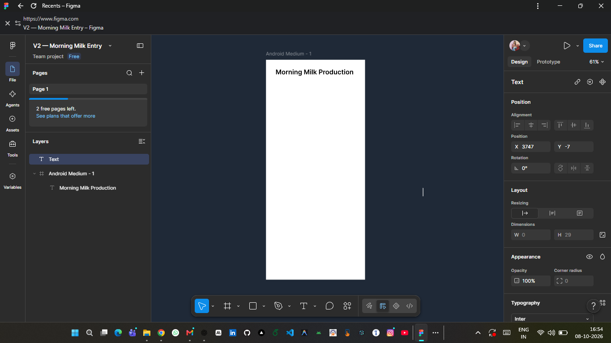
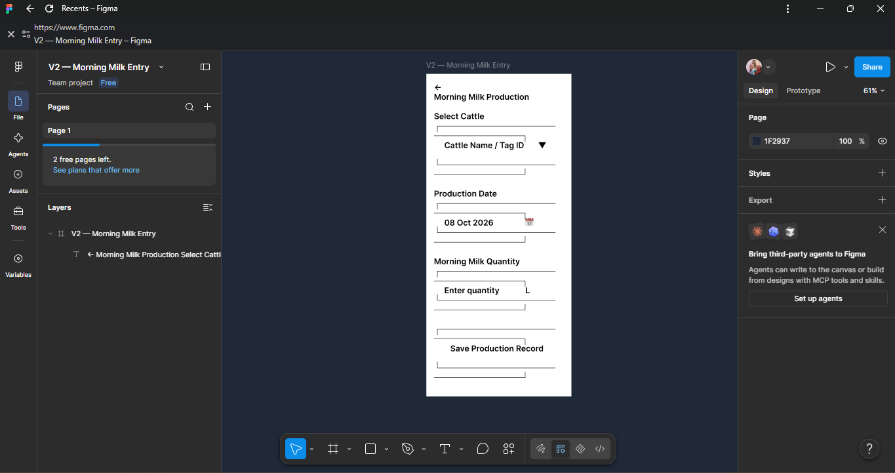
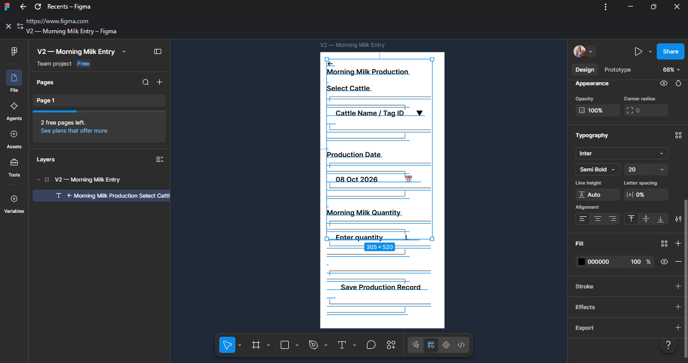

# 🐄 GokulaHealth — Product & Project Management Case Study

Welcome to the detailed case study for **GokulaHealth**, a dairy herd and milk production management application designed to empower small-to-medium dairy farmers with structured digital record-keeping and production analytics.

---

## 📋 Table of Contents
1. [Project Overview](#1-project-overview)
2. [Problem](#2-problem)
3. [Existing V1 Product](#3-existing-v1-product)
4. [User Research](#4-user-research)
5. [Product Opportunity](#5-product-opportunity)
6. [V2 Product Goal](#6-v2-product-goal)
7. [PRD (Product Requirements Document)](#7-prd-product-requirements-document)
8. [User Stories & Acceptance Criteria](#8-user-stories--acceptance-criteria)
9. [Prioritization](#9-prioritization)
10. [Roadmap](#10-roadmap)
11. [Figma / UX Design](#11-figma--ux-design)
12. [Jira / Agile / Scrum Setup](#12-jira--agile--scrum-setup)
13. [Testing & QA](#13-testing--qa)
14. [Release Planning](#14-release-planning)
15. [Feedback & Validation](#15-feedback--validation)
16. [V2.1 Iteration Plan](#16-v21-iteration-plan)
17. [Practical Evidence](#17-practical-evidence)
18. [Documentation Index](#18-documentation-index)

---

## 1. Project Overview
**GokulaHealth** addresses the operational challenges faced by rural dairy farmers who rely on manual, paper-based record keeping for livestock production and health tracking. 

The project evaluates the product from its initial offline prototype (**V1**) through a complete Product & Project Management lifecycle (**V2**), introducing structured requirements, interactive Figma wireframes, Agile Scrum sprint planning in Jira, QA test planning, and post-release iteration frameworks.

---

## 2. Problem
Small-scale dairy farmers experience significant operational friction due to:
* **Paper-Based Record Errors**: Daily morning and evening milk yields are written on paper, leading to lost entries, smudged records, and calculation mistakes.
* **Delayed Anomaly Detection**: Farmers fail to notice sudden drops in milk yield caused by cattle illness or dietary deficiencies until production loss becomes critical.
* **Missed Health Milestones**: Vaccination schedules (e.g., FMD, Deworming) are forgotten, risking herd health.
* **Inaccurate Monthly Accounting**: Calculating monthly average milk production for dairy co-operatives requires manual math, causing disputes and delayed payments.

---

## 3. Existing V1 Product
The original **GokulaHealth V1** was created as an offline Android application built with Kotlin, Room Database, and MVVM architecture. 

### V1 Core Capabilities
* Basic cattle registration (Tag ID, Name, Breed, DOB).
* Offline local milk logging.
* Basic yield graph visualization using MPAndroidChart.
* Local health milestone reminders.

### V1 Limitations & Gaps Identified
* **Lack of Validation**: Farmers could enter invalid numbers (e.g., negative litres or impossible yields like 150L/session).
* **Usability Barriers**: Dense forms with small tap targets caused input friction during early morning barn logs.
* **Missing Production Summaries**: Farmers could view raw daily logs but lacked instant morning vs. evening comparison or automated monthly averages.

---

## 4. User Research
Qualitative field research and user interviews were conducted with smallholding dairy farmers to analyze real-world usage patterns.

### Key Research Insights
1. **Time-Constrained Logging**: Farmers record milk yields immediately after milking (typically 5:30 AM and 5:30 PM) using one hand while handling equipment.
2. **Error Prone Input**: Typing text on small keyboards leads to frequent data corruption. Large numeric keypads and quick tap buttons are essential.
3. **Actionable Insights Needed**: Farmers do not want raw data dumps; they want clear visual feedback showing whether today's yield is above or below their monthly average.

📄 **Artifact**: [View User Research Document](./01-Problem-Discovery/GokulaHealth_User_Research.pdf)

---

## 5. Product Opportunity
Upgrading GokulaHealth to **V2** presents a high-impact opportunity to:
* **Streamline Daily Milk Recording**: Reduce input time from 45 seconds to under 10 seconds per cow.
* **Prevent Bad Data**: Enforce instant validation rules (0.5L – 35.0L range limits per session).
* **Automate Analytics**: Provide instant monthly average yields and morning vs. evening trend analysis without manual calculation.
* **Standardize PM Workflow**: Establish formal Agile backlog management, UX wireframes, and structured QA testing.

📄 **Artifact**: [View Problem Brief](./01-Problem-Discovery/GokulaHealth_Problem_Brief.pdf) | [View V1 Product Analysis](./01-Problem-Discovery/GokulaHealth_V1_Product_Analysis.pdf)

---

## 6. V2 Product Goal
> **"Deliver an intuitive, error-proof milk entry and analytics workflow that enables farmers to log sessions in under 10 seconds and instantly monitor monthly production performance."**

---

## 7. PRD (Product Requirements Document)
The **GokulaHealth V2 PRD** defines functional requirements, user personas, UX guidelines, technical assumptions, and success metrics.

### Key PRD Requirements
* **REQ-1 (Morning Milk Entry)**: Dedicated session screen pre-populated with active cattle list, date/time stamp, and quick-increment yield controls (+0.5L, +1.0L).
* **REQ-2 (Input Validation)**: Instant client-side validation flagging out-of-range values before saving.
* **REQ-3 (Monthly Production Analytics)**: Automated calculation of rolling 30-day average yield and morning vs. evening distribution graphs.
* **REQ-4 (Offline Data Sync)**: Immediate local storage persistence with auto-sync capability.

📄 **Artifact**: [View V2 PRD](./02-Product-Definition/GokulaHealth_V2_PRD.pdf)

---

## 8. User Stories & Acceptance Criteria

### Epic: Production Recording & Data Clarity

#### User Story 1: Morning Milk Entry Logging
* **As a** Dairy Farmer,
* **I want to** select a registered cow and record her morning milk yield,
* **So that** I maintain an accurate daily record without pen and paper.

> **Acceptance Criteria (Gherkin)**:
> ```gherkin
> Given I am on the "Morning Milk Entry" screen
> When I select Cattle "Lakshmi (Tag: TAG-01)" and enter "7.5" in the yield field
> And I tap "Save Production Record"
> Then the system validates the entry within the 0.5L – 35.0L range
> And displays a success message "Record Saved Successfully"
> And updates the daily log list instantly.
> ```

#### User Story 2: Monthly Average Production Analytics
* **As a** Dairy Farmer,
* **I want to** view my herd's monthly average milk yield alongside daily totals,
* **So that** I can assess overall farm productivity and detect drop-offs early.

📄 **Artifact**: Detailed in [GokulaHealth V2 PRD](./02-Product-Definition/GokulaHealth_V2_PRD.pdf) and [Jira Backlog Setup](./05-Agile-Jira/GokulaHealth_V2_Jira_Backlog_Scrum_Setup.pdf).

---

## 9. Prioritization
Feature scoping for V2 was conducted using the **MoSCoW** prioritization method and **RICE** scoring to maximize value within a 2-sprint delivery window.

| Priority | Feature / User Story | MoSCoW | RICE Score | Decision |
|---|---|---|---|---|
| **P0** | Morning Milk Entry & Validation | **Must Have** | 92.0 | Sprint 1 Scope |
| **P0** | Save Production Record & Local Storage | **Must Have** | 88.5 | Sprint 1 Scope |
| **P1** | Monthly Average Yield Calculation | **Should Have** | 76.0 | Sprint 1 Scope |
| **P1** | Morning vs Evening Comparison Graph | **Should Have** | 68.0 | Sprint 2 Scope |
| **P2** | CSV Yield Report Export | **Could Have** | 45.0 | Backlog / V2.1 |
| **P3** | AI Cattle Health Prediction | **Won't Have (V2)** | 22.0 | Deferred |

📄 **Artifact**: [View V2 Prioritization Document](./03-Prioritization-Roadmap/GokulaHealth_V2_Prioritization.pdf)

---

## 10. Roadmap
The product roadmap organizes delivery across short-term and medium-term horizons:

```
V2.0 Core Release (Current)       V2.1 Enhancements (Planned)       V3.0 Advanced Platform (Future)
├─ Morning Milk Entry Flow        ├─ Bulk Multi-Cow Logging         ├─ Co-Operative Cloud Sync
├─ Instant Range Validation       ├─ PDF/CSV Export for Banks        ├─ Automated Feed Calculator
└─ Monthly Yield Analytics        └─ Offline Queue Indicators       └─ AI Disease Early Detection
```

📄 **Artifact**: [View V2 Roadmap Document](./03-Prioritization-Roadmap/GokulaHealth_V2_Roadmap.pdf)

---

## 11. Figma / UX Design
High-fidelity prototypes were designed in Figma to create a clean, high-contrast interface suited for farm environments.

### UX Design Highlights
* **Large Touch Targets**: 48dp minimum button heights for easy tap handling.
* **Visual Validation Feedback**: Clear green highlight for valid entries; bold red error messaging for invalid ranges.
* **Simplified Navigation**: Direct bottom bar navigation between Cattle List, Milk Entry, Analytics, and Health.

📄 **Artifact**: [View Figma Specification PDF](./04-UX-Design/GokulaHealth_V2_Figma_Prototype_Specification.pdf)

---

## 12. Jira / Agile / Scrum Setup
An active Agile Scrum environment was established in Jira Cloud under project key **`GOKULA`**.

### Scrum Setup Summary
* **Project Key**: `GOKULA`
* **Sprint 1 Window**: October 8 – October 22 (2 Weeks)
* **Backlog Items**: Epics, User Stories, Tasks, and Subtasks categorized across To Do, In Progress, and Done columns.
* **Views Configured**: Backlog, Active Scrum Board, Calendar, Timeline, and Project Summary.

📄 **Artifact**: [View Jira Backlog & Scrum Setup PDF](./05-Agile-Jira/GokulaHealth_V2_Jira_Backlog_Scrum_Setup.pdf)

---

## 13. Testing & QA
A structured QA Test Plan was developed covering functional validation, edge cases, boundary value analysis, and UI usability.

### Test Suite Execution Summary
* **Total Test Cases Defined**: 15
* **Execution Status**: *Not Run (Planned Test Suite for V2 Release)*
* **Key Test Coverage**:
  * `TC-MILK-01`: Morning Milk Entry valid submission (0.5L – 35.0L).
  * `TC-MILK-02`: Boundary test for zero / negative input.
  * `TC-MILK-03`: Upper bound test (>35L anomaly warning).
  * `TC-ANALYTICS-01`: Rolling 30-day average calculation accuracy.

📄 **Artifact**: [View Testing & QA Document](./06-Testing-QA/GokulaHealth_V2_Testing_QA_Document.pdf)

---

## 14. Release Planning
The V2.0 release package includes comprehensive Release Notes, deployment readiness checklists, and risk mitigation strategies.

### Release Scope
* Version 2.0.0-rc1
* Planned Rollout Target: Staged rollout to pilot farm co-operatives.
* Key Features Included: Morning Milk Entry screen, client validation engine, monthly yield average cards.

📄 **Artifact**: [View Release Notes](./07-Release-Feedback/GokulaHealth_V2_Release_Notes.pdf)

---

## 15. Feedback & Validation
A post-launch validation plan was drafted to capture user feedback from pilot farmers.

### Feedback Mechanisms
* **In-App Satisfaction Prompt**: Single-tap rating after 10 successful entries.
* **Field Interviews**: Bi-weekly visits to measure reduction in logging errors and user task completion time.

📄 **Artifact**: [View Feedback & Validation Report](./07-Release-Feedback/GokulaHealth_V2_Feedback_Validation_Report.pdf)

---

## 16. V2.1 Iteration Plan
Based on initial usability feedback, a structured V2.1 iteration plan was formulated to prioritize upcoming backlog improvements.

### Priority V2.1 Iterations
1. **Bulk Session Entry**: Allow farmers with 10+ cows to log yields in a table layout.
2. **Offline Sync Status Banner**: Visual indicator confirming local database persistence when offline.

📄 **Artifact**: [View V2.1 Decision & Iteration Plan](./07-Release-Feedback/GokulaHealth_V2_1_Decision_Iteration_Plan.pdf)

---

## 17. Practical Evidence

This section presents practical evidence of the actual Jira Cloud Scrum setup and Figma prototype created for the V2 workflow.

### 📊 Jira Workspace & Agile Planning Evidence

#### 1. Jira Backlog View
Demonstrates the structured product backlog under project `GOKULA`, displaying Sprint 1 scope, Epics (`Production Recording`, `Production Analytics`), user stories, and estimation points.



#### 2. Active Jira Scrum Board
Shows the active Sprint 1 Kanban board with columns (`To Do`, `In Progress`, `Done`) tracking development execution.



#### 3. Jira Calendar View
Illustrates sprint time-boxing and issue target dates across the October release window.



#### 4. Jira Timeline / Roadmap View
Displays epic roadmap alignment and sprint scheduling.



#### 5. Jira Project Summary & Status
Shows project health metrics, completion progress, and issue type distribution.



*Live Workspace Link*: `JIRA_LINK_HERE`

---

### 🎨 Figma Prototype & UX Evidence

#### 1. Figma Main Prototype Canvas
Overview of the complete V2 Android design frame and screen flow in Figma.



#### 2. Morning Milk Entry Screen
The primary recording screen featuring cattle selection, session selection, and large yield input fields.



#### 3. Validation State
Form validation highlighting input constraints and date formats.



#### 4. Success Confirmation State
Record confirmation feedback indicating successful storage persistence.



*Live Prototype Link*: `FIGMA_LINK_HERE`

---

## 18. Documentation Index

All primary project artifacts are archived as standalone PDF files in their respective directories:

| Subfolder | Document Name | GitHub Link |
|---|---|---|
| `01-Problem-Discovery/` | GokulaHealth Problem Brief | [View Document](./01-Problem-Discovery/GokulaHealth_Problem_Brief.pdf) |
| `01-Problem-Discovery/` | GokulaHealth User Research | [View Document](./01-Problem-Discovery/GokulaHealth_User_Research.pdf) |
| `01-Problem-Discovery/` | GokulaHealth V1 Product Analysis | [View Document](./01-Problem-Discovery/GokulaHealth_V1_Product_Analysis.pdf) |
| `02-Product-Definition/` | GokulaHealth V2 PRD | [View Document](./02-Product-Definition/GokulaHealth_V2_PRD.pdf) |
| `03-Prioritization-Roadmap/` | GokulaHealth V2 Prioritization | [View Document](./03-Prioritization-Roadmap/GokulaHealth_V2_Prioritization.pdf) |
| `03-Prioritization-Roadmap/` | GokulaHealth V2 Roadmap | [View Document](./03-Prioritization-Roadmap/GokulaHealth_V2_Roadmap.pdf) |
| `04-UX-Design/` | GokulaHealth V2 Figma Prototype Specification | [View Document](./04-UX-Design/GokulaHealth_V2_Figma_Prototype_Specification.pdf) |
| `05-Agile-Jira/` | GokulaHealth V2 Jira Backlog & Scrum Setup | [View Document](./05-Agile-Jira/GokulaHealth_V2_Jira_Backlog_Scrum_Setup.pdf) |
| `06-Testing-QA/` | GokulaHealth V2 Testing & QA Document | [View Document](./06-Testing-QA/GokulaHealth_V2_Testing_QA_Document.pdf) |
| `07-Release-Feedback/` | GokulaHealth V2 Release Notes | [View Document](./07-Release-Feedback/GokulaHealth_V2_Release_Notes.pdf) |
| `07-Release-Feedback/` | GokulaHealth V2 Feedback & Validation Report | [View Document](./07-Release-Feedback/GokulaHealth_V2_Feedback_Validation_Report.pdf) |
| `07-Release-Feedback/` | GokulaHealth V2.1 Decision & Iteration Plan | [View Document](./07-Release-Feedback/GokulaHealth_V2_1_Decision_Iteration_Plan.pdf) |

---

> [!IMPORTANT]
> **Case Study & Professional Truthfulness Disclaimer**: GokulaHealth is documented here as a personal Product & Project Management portfolio case study. The author created the V2 PRD, Figma wireframe prototypes, Jira Scrum backlog setup, QA test plans, and release documentation to showcase PM/PJM competencies. The original V1 app was developed separately as a software project; Jira, Scrum, and Figma were applied during the V2 PM workflow redesign.
